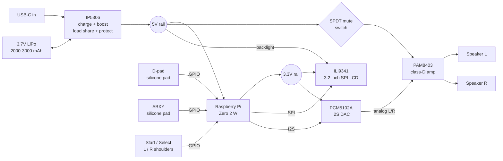

# Marathon


A handheld retro gaming console built around a Raspberry Pi Zero 2 W, designed for long battery life through a custom PCB that places every power, audio, and amplifier IC as a bare chip directly on the board.

## Status

- ✅ **Phase 1, Component identification & research:** complete.
- ✅ **Phase 2, Breadboard prototype:** complete. All subsystems (power, display, audio, buttons) verified end-to-end on 2026-04-03 / 2026-04-04.
- 🔨 **Phase 3, Schematic capture (KiCad):** mostly complete. ERC is clean; test points and a readability pass on the sheet remain.
- 🔨 **Phase 4, PCB layout (KiCad):** in progress. Power, audio, and I²S are routed. The display, buttons, and power key are not, and the Pi has to move back inside the board outline. Not ready for fabrication.

See the [Phases](#phases) table below for the full roadmap.

## Design

Marathon integrates its power management (IP5306), I²S DAC (PCM5102A), and class-D amplifier (PAM8403) as bare ICs on a single custom PCB. The final board is planned for SMT assembly via JLCPCB. The design dedicates internal case volume to a thin, high-capacity LiPo cell, the source of the "Marathon" name.

Design highlights:

- **Bare-chip build.** Every IC is soldered directly to the PCB, not mounted on breakout modules.
- **Single-chip power management.** The IP5306 handles LiPo charging from USB-C, 3.7 V → 5 V boost, load sharing (play while charging), and low-voltage protection.
- **Thin, wide battery.** Target 2000 to 3000 mAh, ≤6 mm thick. The board reserves a 60 x 50 mm area for the cell.
- **Direct I²S audio chain.** Pi → PCM5102A DAC → PAM8403 amplifier → two speakers. Hardware SPDT mute switch cuts amp power for instant silence; fine volume control is handled in RetroPie.
- **Direct GPIO input.** Silicone membrane pads for the D-pad and ABXY, tactile switches for Start, Select, and shoulder buttons. No I²C expander.
- **USB-C with spec-compliant CC resistors.** Works with any USB-C cable, not just A-to-C.
- **Landscape handheld form factor.** A 160 x 75 mm board with the screen in the middle, the D-pad on the left, and the face buttons on the right.

## System Architecture

Power flow and signal flow across the Marathon hardware:



## Phases

| Phase | Scope | Status |
|-------|-------|--------|
| 1 | Component identification & research | ✅ Complete |
| 2 | Breadboard prototype | ✅ Complete (2026-04-03 / 2026-04-04) |
| 3 | Schematic capture (KiCad) | 🔨 Mostly complete |
| 4 | PCB layout (KiCad) | 🔨 In progress |
| 5 | Case design (3D print) | ⏳ Planned |
| 6 | Software & RetroPie tuning | 🔨 Partial (validated during Phase 2) |
| 7 | Fabrication & final assembly (JLCPCB + hand-solder) | ⏳ Planned |

Full phase detail is in [`documentation/PROJECT_PLAN.md`](documentation/PROJECT_PLAN.md).

## Repository Layout

```
marathon/
├── README.md                             this file
├── LICENSE                               CERN-OHL-P v2
├── bom/                                  bill of materials, sourcing, decision log
├── documentation/
│   ├── PROJECT_PLAN.md                   design overview, architecture, phase roadmap
│   ├── PIN_MAPPING.md                    complete 40-pin GPIO map across all subsystems
│   └── PROTOTYPE_BUILD_GUIDE.md          step-by-step breadboard prototype build guide
├── schematics/                           schematic PDF export (planned)
├── pcb/                                  KiCad 10 project: schematic, layout, project libraries
├── case/                                 STL files for the 3D-printed enclosure (Phase 5)
└── software/                             firmware and OS configuration (Phase 6)
```

`case/` and `software/` are placeholders for later phases.

## Build Documentation

- **Breadboard prototype build:** [`documentation/PROTOTYPE_BUILD_GUIDE.md`](documentation/PROTOTYPE_BUILD_GUIDE.md): full walkthrough from USB-C cable harvest through verified I²S audio and joystick input, including all config files and gotchas.
- **Pin mapping:** [`documentation/PIN_MAPPING.md`](documentation/PIN_MAPPING.md): the full 40-pin GPIO table, subsystem breakdowns, and display / audio / button pin assignments.
- **Bill of materials:** [`bom/`](bom/): every component with specs, costs, sourcing, and a running decision log.
- **Project plan:** [`documentation/PROJECT_PLAN.md`](documentation/PROJECT_PLAN.md): architecture overview and the full phase roadmap.

## Hardware Stack

| Subsystem | Component | Notes |
|-----------|-----------|-------|
| Compute | Raspberry Pi Zero 2 W | Mounts on the back of the PCB on standoffs, joined by long-tail header pins |
| Display | ILI9341 3.2" SPI LCD | 18-pin FPC ribbon soldered directly to the PCB |
| Audio DAC | PCM5102A (bare IC) | I²S input, line-level output |
| Audio amp | PAM8403 (bare IC) | Class-D stereo, drives two speakers |
| Power | IP5306 (bare IC) | Charging + boost + load sharing + protection |
| Battery | 3.7 V LiPo, 2000 to 3000 mAh target | Thin cell, ≤6 mm |
| Input | Silicone membrane pads + tactile switches | Direct GPIO, no expander |
| Case | Custom 3D print | Not started. Designed around the PCB once the layout is locked |

## License

Licensed under the [CERN Open Hardware Licence version 2, Permissive (CERN-OHL-P v2)](https://ohwr.org/project/cernohl/wikis/Documents/CERN-OHL-version-2). See [`LICENSE`](LICENSE).
