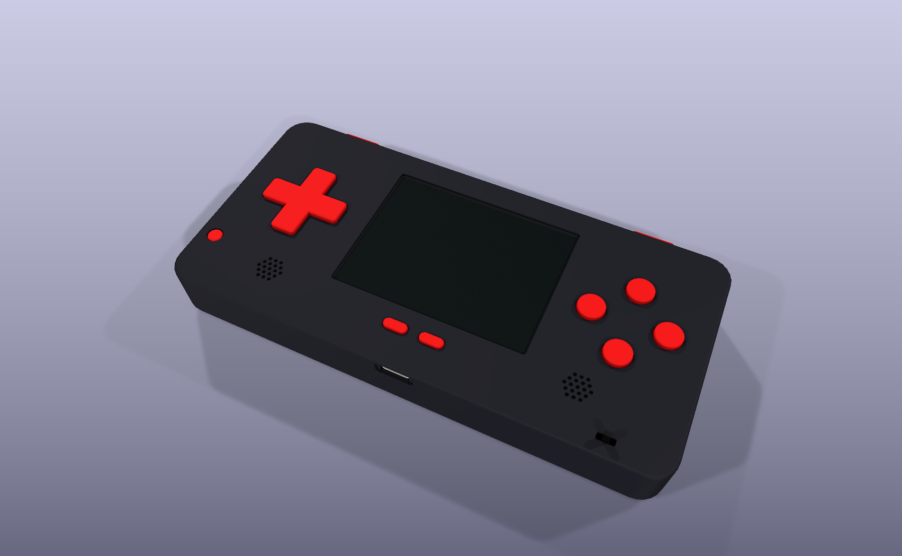

# Case

The 3D-printed case for Marathon, modeled in CadQuery around the board. The design is
[spec 027](../planning/specs/027-CASE-CONCEPT.md).



**Status:** first concept, not printed yet. Several parts it fits around are not in hand (the
silicone pads, the speakers, the mute switch, the LCD panel, and the Alps switches), so their sizes
are assumptions; the spec's "Provisional figures" lists each one and what replaces it.

## What's here

| Path | What it is |
|---|---|
| `case.py` | Builds every part from the board's positions and writes `step/` and `stl/` |
| `board.py` | Reads the outline, case holes, and part positions from `pcb/marathon.kicad_pcb`, and exports the board's 3D models through `kicad-cli` |
| `render.py` | Writes `renders/` |
| `step/marathon-case.step` | The whole assembly, for FreeCAD or any CAD tool |
| `stl/` | One STL per printed part, standing in its print orientation |
| `renders/` | The assembled case from the front and back, an exploded view, a section, and a 1280 x 640 social preview |

The case is 164.2 x 79.2 x 18.5 mm: two shells that clamp the board, split at the board's back. The
first version, 20.4 mm thick, is tagged `case-concept-1`.

## Build and render

```bash
uv run --no-project --python 3.12 --with cadquery==2.5.2 python case/case.py
uv run --no-project --python 3.12 --with cadquery==2.5.2 --with matplotlib python case/render.py
```

CadQuery 2.5.2 has no wheels for Python 3.14, so pin 3.12. The renders need the `org.kicad.KiCad`
Flatpak; they run `kicad-cli` in the same sandbox as `tools/render/render.py`, on a scratch copy of
`pcb/`. Rerun both after a layout change and commit the results. A rebuild rewrites the STEP file
even when nothing changed, as `tools/render/README.md` explains for the stand-in models.

## Tests

```bash
python3 -m unittest discover -s case/tests -p 'test_board.py'
python3 -m unittest discover -s case/tests -p 'test_render.py'
uv run --no-project --python 3.12 --with cadquery==2.5.2 python -m unittest discover -s case/tests -p 'test_case.py'
```

`test_case.py` exports the board through `kicad-cli` and checks the case against it: no part
overlaps the board's parts or another case part, at rest or pressed, the battery space from spec
022 stays clear, each cap reaches its switch or dome, and the body, fasteners, and STLs match the
spec. It takes about a minute and a half.

## Print

PETG or PLA, 0.4 mm nozzle, 0.2 mm layers, no supports. The STLs already stand the right way up.

| STL | Print | Color |
|---|---|---|
| `front-shell.stl` | 1 | black |
| `back-shell.stl` | 1 | black |
| `cap-dpad.stl` | 1 | red |
| `cap-abxy.stl` | 4 | red |
| `cap-start-select.stl` | 2 | red |
| `cap-power.stl` | 1 | red |
| `shoulder.stl` | 2 | red |

## Hardware

- Four M2 x 12 mm socket head screws (DIN 912).
- Four M2 x 3 mm heat-set inserts.
- A 0.5 mm clear acrylic or polycarbonate lens, 71.6 x 55.4 mm with 1.9 mm corners.
- 1 mm closed-cell foam tape for the gasket around the screen, thin double-sided tape for the lens,
  and Kapton tape.
- The two silicone pads and the two 15 mm speakers in `bom/README.md`.

## Assembly

1. On the board, trim the Pi header's pins on the front, under the LCD, to about 0.3 mm, and cover
   them with Kapton tape. The LCD sits on them.
2. Press the inserts into the front shell's four bosses, from the open side.
3. With the front shell face down: tape the lens into its pocket, then lay the gasket on the lens's
   border, outside the window. Make the gasket about twice the gap between the lens and the panel's
   glass; that is 1 mm with the panel on the trimmed pins, a 0.55 mm gap.
4. Drop the caps into their holes and the shoulder buttons into their slots, then lay the silicone
   pads over the D-pad and ABXY caps.
5. Glue the speakers into their rings, facing the grilles.
6. Lower the board in face down, USB-C first into its notch.
7. Fit the back shell and drive the four screws.

The microSD card and the Pi's ports are reached with the back shell off.
