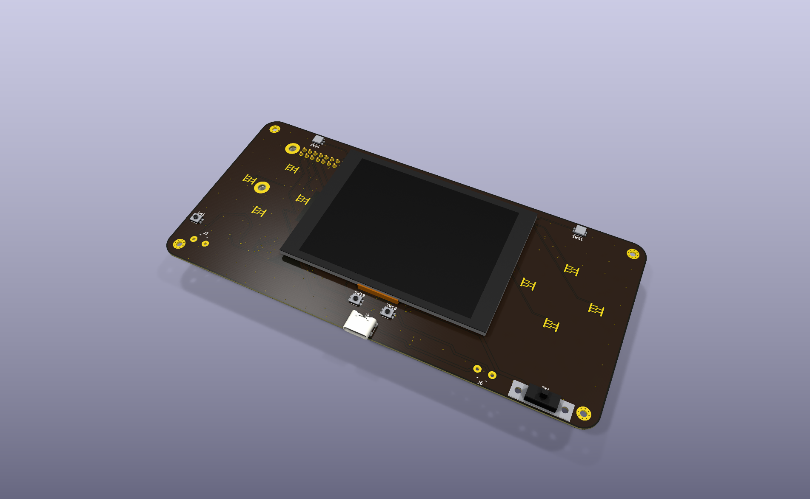
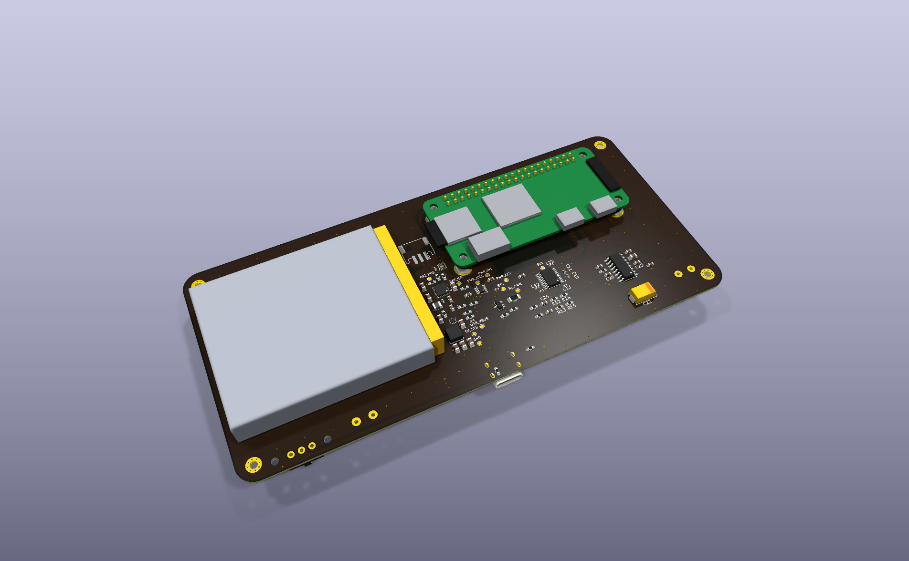

# PCB

KiCad 10 project for the Marathon main board. Open `marathon.kicad_pro`. The schematic lives here with the layout because KiCad keeps a project's files in one folder.

**Status:** Phase 4, in progress. **Not ready for fabrication.**

- 160 x 75 mm, 2 layers.
- Placed: every part. The Raspberry Pi mounts on the back, inside the outline and clear of the battery area.
- Routed: every net, with ground pours on both layers that fill the rounded corners.
- Four plated M2 case holes (H1 to H4), tied to GND, 5 mm in from each edge.
- 13 test pads (TP1 to TP13) on the back, labeled with their net names, outside the Pi, the microSD card's overhang, the battery and the antenna areas.
- The `PI_ANTENNA_KEEPOUT` rule area keeps tracks, vias, pads and pours off both layers under the Pi Zero 2 W's antenna, plus 5 mm, or 4.2 mm on the left where the D-pad's right contact (SW13) sits. The antenna sits on the Pi's edge opposite the GPIO header, between the mini-HDMI and USB data ports.
- U2 (PCM5102A) and U3 (PAM8403) use their library footprints flipped to the back, so their pin order matches the parts (fixed 2026-11-06). Their capacitors moved with them, and each bypass capacitor sits at the pin the schematic names.
- Footprints named `PROVISIONAL` still need checking against the real parts. The Alps switch footprints follow Alps' published land patterns.
- `marathon.kicad_dru` allows 0.12 mm clearance inside the U5 (SOT-563) and U6 (TSOT-23-8) courtyards, whose stock land patterns put pads 0.15 mm apart.
- The BQ25616 uses a project copy of KiCad's RTW footprint with four 0.3 mm vias in the exposed pad, the board's minimum drill.
- The stackup sets a black solder mask and an ENIG finish on the 1.0 mm board.
- `Marathon.3dshapes/` holds stand-in 3D models for the project footprints, and BT1 is a board-only stand-in for the battery. `tools/render/` builds them and the renders.

## Renders




Flat views: [`renders/top.png`](renders/top.png) and [`renders/bottom.png`](renders/bottom.png). To rebuild them, see [`../tools/render/README.md`](../tools/render/README.md).

## Checks

| Check | Result |
|-------|--------|
| ERC | 0 violations |
| DRC | 0 errors, 0 warnings |
| Unrouted connections | 0 |
| Schematic / PCB parity | 0 issues |

To re-run them from the repo root:

```bash
kicad-cli sch erc pcb/marathon.kicad_sch
kicad-cli pcb drc --refill-zones --schematic-parity pcb/marathon.kicad_pcb
```

## Planned

- A `fab/` folder with Gerbers, drill files, BOM, and pick-and-place files for JLCPCB.
