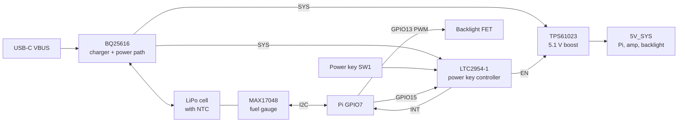

# Power design: clean shutdown, battery level and charge current

- **Status:** draft
- **Issue:** spudger/marathon#11
- **PRs:** none yet
- **Draft:** none
- **Plans:** none yet

## Why

Marathon is meant to be thin enough to carry in a pocket and to last a long gaming session. The
current power section, a single IP5306, gets in the way of both:

- **No clean shutdown.** The power key reaches only the IP5306, and holding it for more than 2 s
  cuts 5 V while Linux is still writing to the SD card.
- **The board can't turn itself off after Linux halts.** The IP5306 turns off only below 45 mA
  for 32 s. A halted Pi Zero 2 W draws about 50 mA, and the backlight adds about 85 mA, so a
  halted board keeps draining the cell.
- **No warning before the battery runs out.** The IP5306 drops 5 V near 3.0 V with no signal to
  the Pi.
- **Too much charge current for a thin cell.** The IP5306 charges at a fixed 2.1 A. The thin
  2000 to 2500 mAh cells found so far allow 1.0 to 1.25 A at most.
- **No battery temperature check.**
- **C22 is too tall.** It's a 470 µF electrolytic, 8 x 10 mm, on the back, taller than the 6 mm
  battery.

## Decisions

The owner approved these while scoping issue #11:

1. A press turns the device on, and a press while it's on starts a clean shutdown. A long hold forces it off if the Pi
   freezes.
2. The screen shows the battery percentage, warns when the battery is low, and the device shuts down cleanly before the cell runs out. A MAX17048 fuel gauge on the
   Pi's free I2C pins reads the level.
3. Software sets the backlight brightness and turns the backlight off at shutdown.
4. The cell charges at no more than its rated current, even if a full charge takes 2 to 3 hours. This replaces the IP5306.
5. Charging stops when the cell is too hot or too cold.
6. The battery space stays 60 x 50 mm and at most 6 mm thick. The owner picks the cell from the
   requirements below.
7. Option 1: a BQ25616 switching charger with a separate TPS61023 boost. The fallback is a
   BQ24074 linear charger, if the BQ25616's input limit can't be confirmed.
8. The USB input is limited to about 1.5 A, which assumes a USB-C wall charger.

The owner left the circuit details to this spec: part values, the power key controller, the C22
replacement, the pin choices and the Pi software settings.

## Design

### Charger: BQ25616

A TI BQ25616RTWR (LCSC C2866447, WQFN-24, 4 x 4 x 0.8 mm) replaces U1, the IP5306. It's a
standalone switching charger with a power path: USB runs the system while it charges the cell, and the cell
supplements USB when the load is higher than the input limit. Nothing about charging depends on
software.

| Setting | Part | Value | Source |
|---|---|---|---|
| Charge current | RICHG, ICHG pin to GND | 750 Ω 1%: 0.90 A typical, 0.96 A worst case | KICHG 639 to 715 AΩ |
| Input current limit | RILIM, ILIM pin to GND | 340 Ω 1%: 1.41 A typical, 1.49 A worst case | KILIM 459 to 500 AΩ |
| Charge voltage | VSET pin | left open: 4.208 V | VSET over 50 kΩ |
| Temperature window | TS divider, REGN to TS to GND, 103AT-2 NTC | about 5.3 kΩ and 31.1 kΩ, 1%: charges only between 0 °C and 45 °C | Section 9.3.7 and the hot/cold table |
| Input detection | D+ and D- | both left open: unknown adapter, so ILIM sets the limit | Section 9.3.3.4.1 |
| OTG boost | OTG pin | tied to GND; the charger's own boost is never used | Pin table: OTG can't float |
| Charge enable | CE pin | tied to GND: charging always enabled | Pin table |
| ACFET | VAC, ACDRV | VAC tied to VBUS, ACDRV open | Pin table |
| Status | STAT, PG | not connected | |

- **VSET must never reach GND.** A short to GND selects 4.352 V, which overcharges a standard 4.2 V
  cell. The layout keeps the VSET pin unconnected, with no pad or trace next to it at GND.
- **Missing or broken NTC fails safe.** An open NTC reads as cold and a shorted one as hot. Either
  way charging stops. A 2-wire cell plugged in without a sensor never charges.
- **Input faults:** above 14.2 V on VAC the charger stops. VBUS and PMID are rated to 22 V.
- **Deep discharge:** below about 2.4 V the BATFET latches off until USB is plugged in. Software
  shuts down well before that, at about 3.4 V.
- **Support parts per the datasheet:**
  - 1 µH inductor, saturation current at least 3 A, at most 2 mm tall
  - 1 µF on VBUS, 10 µF on PMID, 10 µF on SYS, 10 µF on BAT
  - 4.7 µF on REGN, rated 10 V
  - 47 nF bootstrap capacitor between BTST and SW

TI engineers answered this in three E2E threads, read through search results because the forum
blocks direct fetches: with D+ and D- left open, the BQ25616 detects an unknown adapter and ILIM
sets the input limit. TI's application report SLUAA94 says the same for the BQ25616. The datasheet's detection text
agrees: data contact detection times out after 0.5 s, and "unknown" selects ILIM. The bench
check below confirms it on the built board. If it fails, the fallback is decision 7's BQ24074.

### Boost: TPS61023

A TI TPS61023DRLR (LCSC C919459, SOT-563, 1.2 x 1.6 x 0.6 mm) makes 5V_SYS from the charger's
SYS rail.

- **Output:** 5.1 V set by a feedback divider (VREF 0.595 V typical). The datasheet's
  application gives 5 V at 1.5 A from a 3.6 V input. The valley current limit is 3.7 A.
- **Load:** about 1.05 A peak at 5.1 V, with Pi load, full-volume audio and the backlight. At a
  3.2 V cell that's about 1.9 A from the cell.
- **EN:** driven by the LTC2954's EN output, pulled up to SYS through 1 MΩ. The LTC2954 holds EN low while the device is off, so a 100 kΩ pull-up would waste 37 µA; 1 MΩ wastes about 4 µA. In shutdown the
  output is fully disconnected from the input, and the chip draws 0.1 µA typical from VIN.
- **Inductor:** L1 stays, as 1 µH with saturation current at least 4.5 A, on the existing
  XAL4020 footprint (2.1 mm tall).
- **Output capacitance:** the datasheet allows up to 1000 µF effective. C3 to C6 and the new C22
  stay within that. Above 40 µF, TI's section 8.2.2.4 calls for a feedforward capacitor across the
  top feedback resistor that puts a zero at 1 kHz. The schematic PR sizes it with the datasheet's
  Equation 10, and the bench checks include a load step.

### Power key controller: LTC2954-1

An Analog Devices LTC2954CTS8-1 (LCSC C683782, TSOT-23-8, 1 mm tall) runs the power key. It is
powered from SYS (2.7 to 26.4 V, 6 µA typical). It costs about $6.70, more than a transistor
latch, but its timers and kill input are specified in the datasheet rather than built from parts
this project would have to characterize.

| Pin | Connection | Behavior |
|---|---|---|
| PB | SW1 to GND | Internal 100 kΩ pull-up |
| ONT | 0.15 µF X7R ±10% to GND | Turn-on needs a hold of 0.7 to 1.5 s |
| PDT | 1.5 µF X7R ±10% to GND | Forced off after a hold of 6.8 to 14.5 s, typically about 9.7 s |
| EN | TPS61023 EN, 1 MΩ pull-up to SYS | Open drain, released high when on |
| INT | Pi GPIO7, 10 kΩ pull-up to 3V3 | Pulled low while the key is pressed with the device on |
| KILL | Pi GPIO15, 10 kΩ pull-up to 3V3 | Low turns the device off. Blanked for 400 to 650 ms after turn-on |

- **Timing ranges.** The ranges in the table are worst cases, not typical values.
  - The datasheet sizes both capacitors as C = 1.56 × 10⁻⁴ µF/ms × (t − 1 ms). Its 1500 pF test
    points (tONT and tPDT, 9 to 13.5 ms) give 5.33 to 8.33 s per µF once the fixed 1 ms is taken
    out.
    The fixed parts add 26 to 41 ms (tDB,ON) and 52 to 82 ms (tPD,MIN).
  - Capacitance is taken as ±15%: ±10% part tolerance plus about ±5% for X7R between 10 °C and
    40 °C.
- **Turn-on hold:** 0.7 to 1.5 s, so a key pressed by accident in a pocket doesn't turn the
  device on. Without ONT's capacitor it would be 32 ms.
- **Forced-off hold:** at least 6.8 s. A press of 0.5 to 6 s is a clean shutdown: it starts at
  0.5 s and is never cut short by the forced off. With PDT left open, a 64 ms tap would
  cut power, so the capacitor is required. A forced off is certain by 14.5 s.
- **KILL:** must be high within the blanking time, at least 400 ms after turn-on. The pull-up to 3V3 does that as soon as the
  Pi's 3.3 V regulator starts, a few milliseconds after 5 V. The Pi's default pull-down on GPIO15
  (about 50 kΩ) leaves KILL at about 2.75 V, well above its 0.6 V threshold.

### Fuel gauge: MAX17048

A MAX17048G+T10 (LCSC C2682616, TDFN-8, 2 x 2 mm) measures the cell and reports its charge in
percent over I2C at address 0x36.

- **Power:** VDD and CELL connect to the cell, beside the battery connector, with a 1 µF
  capacitor. It draws 23 µA active and 3 µA in hibernate.
- **Bus:** SDA to GPIO2 and SCL to GPIO3. The Pi already has 1.8 kΩ pull-ups to 3V3 on those
  pins, so no new pull-ups. SDA and SCL tolerate the bus while VDD is at cell voltage.
- **ALRT:** not connected. Software polls the gauge, because no GPIO is free for it.

### Backlight: AO3400A

An AO3400A N-channel MOSFET (LCSC C20917, SOT-23) replaces R31, the 0 Ω link between the LCD
cathodes and GND.

- **Gate:** driven from GPIO13 (PWM1) through 100 Ω, with a 100 kΩ pull-down, so the backlight
  stays off until the Pi drives the pin.
- **R30 stays** at 22 Ω from 5V_SYS to LEDA.

### Battery connector and cell requirements

B1 becomes the 3-pin version of the current part, JST S3B-PH-SM4-TB, for BAT+, NTC and GND. The
board's pin order must match the chosen cell's drawing before the board is ordered: JST-PH cells
don't share one pin order.

The cell must meet all of these:

| Requirement | Value |
|---|---|
| Size, including PCM and tolerance | fits 60 x 50 mm, at most 6.0 mm thick |
| Chemistry | LiPo, 4.2 V full charge, not a 4.35 V high-voltage cell |
| Maximum charge current | at least 1.0 A |
| Continuous discharge | at least 2 A |
| Protection (PCM) | included, with overcurrent trip above 3 A |
| Temperature sensor | 10 kΩ NTC, B = 3435 (103AT type), on a third wire. Otherwise, add one to the harness against the cell |

The closest candidate found, the VCELL VP505060 (2000 mAh, 1 A maximum charge, NTC optional),
measures up to 50.5 x 62.5 mm with its PCM, 2.5 mm longer than the space. Common 505060 cells
run that long once the PCM is folded on. Under decision 6 the cell must fit 60 x 50 mm; see
Open question.

### Bulk capacitor: C22

C22 becomes a polymer capacitor of at least 220 µF, rated 10 V, at most 3 mm tall, in a 7343
(D) case, for example a Panasonic POSCAP or KEMET T520. The schematic PR picks the part from
LCSC stock.

### Pin assignments

| GPIO | Use | Why this pin |
|---|---|---|
| GPIO2, GPIO3 | I2C1 to the fuel gauge | The Pi's I2C pins, already pulled up |
| GPIO7 | LTC2954 INT, input | fbcp-ili9341 doesn't touch CE1 at start (built without DISPLAY_USES_CS1), and sets it to input when it exits. An input is safe with either |
| GPIO13 | Backlight PWM | The only free pin with hardware PWM. GPIO12 and GPIO18 are taken, and GPIO19 is I2S |
| GPIO15 | LTC2954 KILL, output | Needs the serial console off, which GPIO14's use as the B button already requires |

GPIO7 can't be KILL, because fbcp-ili9341 sets it to input when it exits. That would leave KILL
high, and the device would never turn off.

### Pi software settings

The software phase applies these. They're listed here so the hardware matches them.

- `/boot/config.txt`:
  - `dtoverlay=gpio-shutdown,gpio_pin=7,active_low=1,gpio_pull=up,debounce=500`. A key press
    must last 0.5 s to start a shutdown, so a brush during play doesn't end the game.
  - `dtoverlay=gpio-poweroff,gpiopin=15,active_low=1`. Pulls KILL low at the end of shutdown.
    The overlay's notes warn that with `active_low`, the pin can fall low during boot or a
    reboot, once the SoC resets its pins to their default pull-down. The 10 kΩ pull-up on KILL
    outweighs GPIO15's 50 kΩ pull-down, so the pin stays high. The bench checks prove it.
  - `dtparam=i2c_arm=on`.
  - `gpio=13=op,dh`. The firmware turns the backlight on early in boot, before PWM takes over.
  - `dtoverlay=pwm,pin=13,func=4`. This only routes PWM1 to GPIO13; it sets no period or duty.
  - `enable_uart=0`.
  - SPI: no kernel driver may claim GPIO7. Use `dtoverlay=spi0-1cs` if the kernel SPI driver
    stays on, or leave it off, because fbcp-ili9341 drives SPI0 directly.
- **A backlight service:** at boot it sets PWM1's period to 40,000 ns (25 kHz) and its duty to the
  saved brightness. It stores brightness changes, and at shutdown it sets the duty to 0 before
  the power is cut.
- **A battery service:** reads the gauge every 30 s, shows a warning at 10 %, and runs
  `systemctl poweroff` at 3 % or when the cell reads below 3.40 V on three reads in a row.

### Behavior

| State | What happens |
|---|---|
| Off, on battery | The TPS61023 is off. The cell feeds only the charger, controller, gauge and EN pull-up, about 25 to 45 µA in total |
| Off, USB plugged in | Charges at 0.9 A between 0 °C and 45 °C. The device stays off |
| Key held 1.5 s | EN goes high, 5 V comes up, the Pi boots, and KILL goes high |
| Key pressed 0.5 to 6 s while on | INT goes low, and Linux shuts down cleanly. At the end, GPIO15 pulls KILL low, and 5 V goes off |
| Key held 14.5 s | Forced off, for a frozen Pi |
| Battery at 3 % | The battery service shuts down cleanly |
| On, USB plugged in | USB runs the device. The leftover input current, up to about 1.4 A total, charges the cell |

## What this removes

- U1, the IP5306, and its footprint `pcb/Marathon.pretty/IP5306_eSOP8_EP2.09x2.09mm.kicad_mod`
  and symbol.
- The IP_KEY net. SW1 moves to LTC2954 PB.
- The 470 µF electrolytic C22 and R31.
- C1 to C6 as IP5306 parts. The schematic PR reuses them where the new datasheets call for the
  same values.

## Open question

The battery space is 60 x 50 mm, and the common 2000 mAh 505060 cell measures up to 62.5 mm
long with its PCM. Decision 6 fixes the space at 60 x 50 mm, so the cell must fit it, unless
the owner changes that decision. The author has asked whether to grow the space to about 63 mm.
The hardware PR doesn't start until the owner answers.

## Experience open

Each of these needs a discovery issue before the software phase:

- How the battery percentage and the low-battery warning look on screen.
- How the owner changes the brightness during play.

## Known limits

- **If Linux hangs with the screen on,** nothing shuts it down at low battery. The cell's PCM and
  the charger's 2.4 V latch-off still protect the cell, but the SD card isn't protected.
- **A plain 500 mA USB port** draws up to the full ILIM setting, which is more than USB 2.0
  allows. The design assumes a USB-C wall charger.
- **Off-state drain** is about 25 to 45 µA: charger 9.5 µA, LTC2954 6 µA, gauge 3 to 23 µA and
  the EN pull-up about 4 µA. That would take about 5 years to drain a 2000 mAh cell, so the cell's
  own self-discharge dominates.
- **The fuel gauge's default model** is a generic LiPo model. Its percentage may drift a few
  percent until a cell-specific model is loaded.

## PRs

1. **Hardware (build flow):** the schematic, symbols, footprints and layout for everything above,
   plus updates to `README.md`, `bom/README.md`, `documentation/PIN_MAPPING.md` and
   `documentation/PROJECT_PLAN.md`. Verified with verify-marathon.
2. **Software (build flow, Phase 6):** the `config.txt` lines and the backlight and battery services above, in
   `software/`.
3. **Discovery:** the two experience-open items.

## Finish condition

For the hardware PR, each check runs on the PR's head:

- verify-marathon: ERC 0, DRC 0 errors, 0 unconnected, 0 parity issues.
- A netlist script prints PASS for each of these:
  - VSET has no connection.
  - D+ and D- have no connection.
  - OTG and CE connect to GND.
  - RICHG is 750 Ω and RILIM is 340 Ω, both 1% or better, read from the value and tolerance
    fields. At their lowest values, 742.5 Ω and 336.6 Ω, the worst-case currents are 0.96 A and
    1.49 A.
  - TS sits between RT1 to REGN and RT2 to GND, and B1's NTC pin connects to it.
  - GPIO7 connects to INT, GPIO15 to KILL, GPIO13 to the FET gate, and GPIO2/GPIO3 to the gauge.
  - PDT and ONT each have their capacitor.
  - No net still names U1, the IP5306.
- No part on the back is taller than 3 mm, read from each footprint's 3D model or datasheet.
- All new parts fit inside the board outline without entering the battery space or the Pi
  keep-out.

On the built board, inconclusive until one exists:

- From a bench supply at 3.3 V standing in for the cell, with the Pi, display and amp connected:
  - A 1.7 s hold turns it on, and a 0.1 s tap does not.
  - It boots to the desktop.
- `sudo reboot` restarts the Pi without cutting 5 V.
- A short press shuts down cleanly, and 5 V reads 0 V within 30 s of the halt.
- A 15 s hold forces it off. A 6 s press shuts down cleanly with no forced off.
- Charge current is 0.85 to 0.96 A from a USB-C charger, measured at the cell.
- With the NTC replaced by fixed 1% resistors, charging stops at 33 kΩ (cold), runs at 10 kΩ
  (25 °C) and stops at 4.3 kΩ (hot). The nominal cutoffs are 27.3 kΩ (0 °C) and 4.9 kΩ (45 °C);
  the test points sit outside the charger's threshold tolerance.
- With the NTC open or shorted, it doesn't charge.
- The input current stays under 1.5 A while the device runs and charges.
- The battery service reads a percentage from address 0x36.
- A discharge run from full: the warning shows at 10 %, and Linux finishes shutting down before
  5V_SYS drops, confirmed in the journal on the next boot.
- Changing the brightness changes the PWM duty, and the backlight is off before 5 V goes off.
- A 0.2 to 1 A load step on 5V_SYS settles without ringing.

## What else uses this

Searches run on main at 8ca4aba:

- `git grep -l -i IP5306`:
  - `README.md`: feature list, mermaid diagram, parts table.
  - `bom/README.md`: power section, decisions log.
  - `documentation/PIN_MAPPING.md`: power notes.
  - `documentation/PROJECT_PLAN.md`: architecture table and phases.
  - `documentation/PROTOTYPE_BUILD_GUIDE.md`: the breadboard build. It stays as the prototype
    record.
  - `pcb/marathon_symbols.kicad_sym` and the IP5306 footprint.
- `git grep -l -E 'IP_KEY|BAT_POS|R31|C22|LCD_LED_K'`:
  - `pcb/marathon.kicad_sch`.
  - `pcb/marathon.kicad_pro`: netclass patterns for `/BAT_POS`, `/5V_SYS` and `/USB_VBUS`.
  - `bom/README.md`.
  - `documentation/PIN_MAPPING.md`.
- `grep -n -E 'GPIO(2|3|7|13|15)' documentation/PIN_MAPPING.md`: all five are marked unused
  today. The hardware PR assigns them.
- `grep -rn spi= documentation/PROTOTYPE_BUILD_GUIDE.md`: the prototype uses `dtparam=spi=on`,
  which claims GPIO7 as a chip select. The software PR replaces it as described above.
- `software/` holds only a README, so nothing else reads these pins yet.

## Sources

- BQ25616 datasheet, SLUSDF7A: <https://www.ti.com/lit/ds/symlink/bq25616.pdf>
- TI E2E, D+/D- left open: <https://e2e.ti.com/support/power-management-group/power-management/f/power-management-forum/1540770/bq25616-does-leaving-the-d-d--pins-as-nc-default-to-the-input-current-limit-set-by-ilim>
- TI SLUAA94, USB D+/D- input current limit detection: <https://www.ti.com/lit/an/sluaa94/sluaa94.pdf>
- TPS61023 datasheet: <https://www.ti.com/lit/ds/symlink/tps61023.pdf>
- LTC2954 datasheet, read from the RS mirror: <https://docs.rs-online.com/3758/0900766b81320bb1.pdf>
- MAX17048 product page and datasheet: <https://www.analog.com/en/products/max17048.html>
- IP5306 datasheet, LCSC C181692: <https://www.lcsc.com/datasheet/C181692.pdf>
- Pi Zero 2 W halted current: <https://andrejacobs.org/b24/electronics/raspberry-pi-zero-2-w-temperature-and-power-consumption/>
- Raspberry Pi overlays: <https://github.com/raspberrypi/firmware/blob/master/boot/overlays/README>
- fbcp-ili9341 SPI setup: <https://github.com/juj/fbcp-ili9341/blob/master/spi.cpp>
